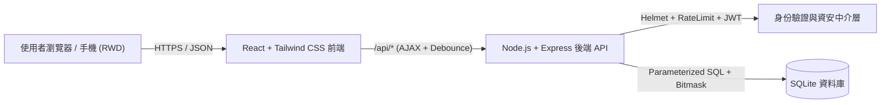

# 北護智慧預選課與課程規劃系統 (NTUNHS Smart Course & Schedule Planner)

本專案針對現行學校「課程查詢系統」之痛點進行前後端重構與優化，提供輕量化 AJAX 檢索、位元遮罩精確節次比對、個人預排週課表與空堂反向找課、跨系學程標籤篩選、修課資格預審、雙語介面（中／英）、RWD 響應式設計，以及無個資課表分享等功能。

## 系統架構圖



## 主要解決痛點

1. **輕量化搜尋與伺服器端分頁**：改採前後端分離 + 防抖（300ms）AJAX JSON 局部更新，取代傳統 WebForms 整頁 PostBack，並支援分頁避免大量查詢逾時。
2. **精確節次位元比對（嚴格／彈性切換）**：後端以 14-bit 位元遮罩（Bitmask）計算節次交集，解決勾選指定節次卻帶出跨時段課程的問題。
3. **個人預排週課表與空堂反向找課**：點擊週課表上的空堂格位（`+ 找課`），即可自動篩選該時段可選課程，並即時檢查衝堂與學分統計。
4. **跨系學程標籤與資格預審**：課程列表顯示所屬學分學程標籤與抵免辦法；針對年級或先修條件不符之課程提供視覺化標記與白話提示。
5. **雙語介面與 RWD 響應式卡片**：內建中／英雙語欄位切換，並提供手機版卡片檢視與點擊彈窗，取代桌機限定之 Hover 互動。
6. **去識別化課表分享**：產生唯一分享連結時僅儲存課程清單，不包含學號與姓名等個人隱私資訊。

## 本地開發與執行步驟

### 1. 環境需求
- Node.js 22.5+（建議 v24 以上，內建 `node:sqlite`）

### 2. 設定環境變數
複製 `.env.example` 為 `.env` 並設定金鑰（切勿將 `.env` 提交至 GitHub）：

```bash
cp .env.example .env
```

### 3. 安裝套件與建置前端

```bash
npm install
npm --prefix client install
npm run build
```

### 4. 啟動伺服器

```bash
npm start
```

啟動後可於瀏覽器開啟 `http://localhost:3001`（若使用前後端分離開發模式，可同時執行 `npm run dev` 與 `npm run dev:client` 並開啟 `http://localhost:5173`）。

## 資安合規設計

- 所有敏感設定（`JWT_SECRET`、初始測試密碼）皆透過環境變數 `.env` 注入，無任何硬編碼金鑰。
- 資料庫查詢全面使用參數化查詢（Parameterized Queries）防止 SQL Injection。
- 使用 `helmet` 設定 HTTP 安全標頭（CSP、X-Frame-Options 等）及 `express-rate-limit` 防止暴力破解。
- 密碼採用 `crypto.scryptSync` 加鹽雜湊與 `crypto.timingSafeEqual` 比對。
